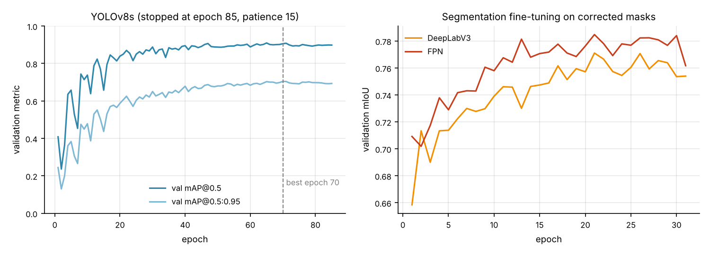
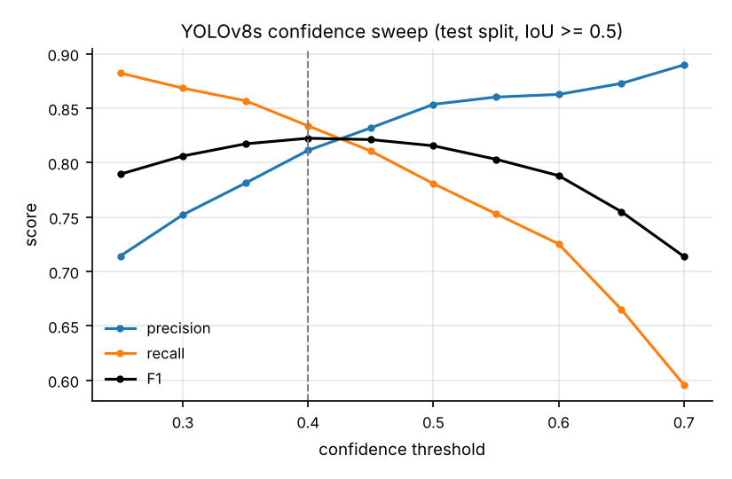
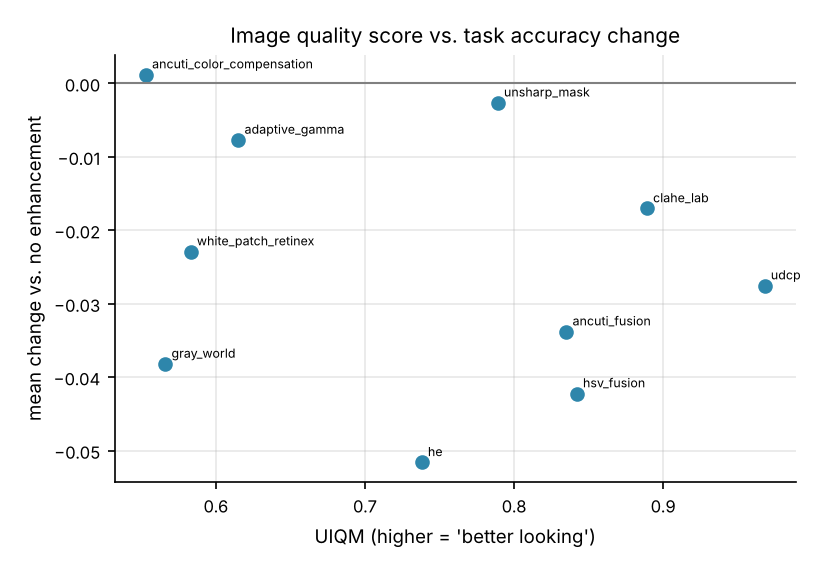
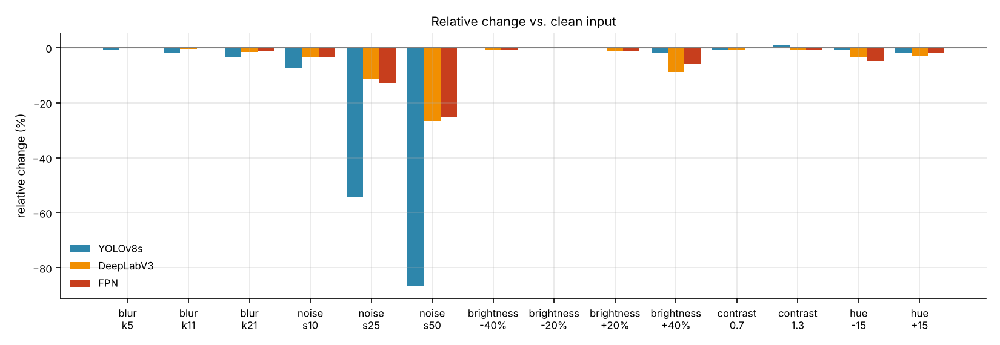

# Camera-based pipeline perception for a small AUV: detection, segmentation and edge deployment

*Technical report accompanying the [auv-pipeline-perception](../README.md) repository. Every number here is either derived from a file in `results/` by a script in `analysis/`, or marked as coming from the thesis measurements. [`PROVENANCE.md`](PROVENANCE.md) maps each number to its source.*

## Abstract

Pipeline following is a basic autonomy task for inspection AUVs. On a low-cost vehicle with a single camera and an embedded GPU, it reduces to two questions: can a small network find the pipe reliably, and can it do so in real time on the vehicle's computer? This work trains two single-class detectors (YOLOv8s, YOLOv11s) and two semantic segmentation networks (DeepLabV3 and FPN, both with a ResNet-34 encoder) on pool and sea footage, and deploys all four as TensorRT FP16 engines on a Jetson Orin Nano Super.

On the detection test split, YOLOv8s reaches mAP@0.5 = 0.873 and YOLOv11s 0.870. On a separate segmentation test split, FPN reaches mIoU = 0.782 and DeepLabV3 0.773. On the vehicle computer, both detectors exceed 30 FPS on real video in MAXN_SUPER mode, and the segmentation models do not.

Four secondary analyses are reported: a confidence-threshold sweep for the downstream tracker, an ablation of ten classical underwater enhancement methods, a synthetic-corruption robustness test, and a per-subset error analysis. The most useful results are negative: none of the enhancement methods improved accuracy, and the apparent robustness advantage of the segmentation models is confounded by their training augmentation. A post-hoc audit also found frame-level leakage between the training and test splits of the segmentation set, so its test scores should be read as optimistic.

## 1. Problem and constraints

The vehicle carries one forward/downward camera and a Jetson Orin Nano. The perception module has to output, for every frame, either a pipe bounding box (enough for heading control) or a pipe mask (needed for a centre-line estimate). A Kalman-filter tracker downstream smooths these outputs over time.

This sets three requirements:

1. Recall must be high enough that the tracker is not starved.
2. False positives must be rare, because each one pulls the tracker off the pipe.
3. Throughput must stay at or above roughly 30 FPS on the Jetson.

Underwater imagery makes all three harder. Colour attenuation, turbidity, backscatter and low contrast change from site to site, and the training data covers only a few sites.

## 2. Data

**Detection set.** Frames from team-recorded pool and sea videos were merged with several third-party Roboflow exports and labelled with a single class (`pipe`). Near-duplicates were removed with a perceptual hash (8×8 DCT pHash, Hamming distance ≤ 5), which left 10,017 images. These were split into 8,792 train, 629 validation and 596 test images.

**Segmentation set.** This is a separate set of 2,533 images, split 2,025 / 252 / 256. During the work, 1,129 of its masks were corrected by hand. Only 205 of the 256 test images contain a pipe, and the segmentation metrics are computed on those 205.

Because the two tasks use different images and splits, detection and segmentation metrics are reported separately and never compared directly.

**Known split problem.** Both sets were split at frame level, not at video level. Section 6 quantifies the consequences.

## 3. Methods

### 3.1 Models and training

| | Detection | Segmentation |
|---|---|---|
| Models | YOLOv8s (11.1 M params), YOLOv11s (9.46 M) | DeepLabV3 (26.0 M), FPN (23.2 M); ResNet-34 encoder, ImageNet weights |
| Framework | Ultralytics | segmentation_models_pytorch |
| Input | 640 × 640 | 512 × 512 |
| Optimiser, LR | SGD, 0.01 | Adam, 1e-4 |
| Loss | Ultralytics default (box, cls, DFL) | Dice + BCE |
| Augmentation | Mosaic, HSV, horizontal flip | HSV, brightness, **GaussNoise**, blur |
| Stopping | patience 15 (stopped at epoch 85; best epoch 70) | patience 10 (both stopped at epoch 31; best epoch 21) |
| Seed | 0 | 42 |

The final segmentation runs resumed from a short preliminary run on the corrected masks.

### 3.2 Untrained controls

To check that the evaluation pipeline behaves sensibly, each architecture was also evaluated with no task training. The detectors used COCO weights, which contain no pipe class. The segmentation models used an ImageNet encoder and a randomly initialised decoder. These controls score near zero (mAP@0.5 0.061 / 0.079; mIoU 0.145 / 0.036), as expected. Their purpose is to show that the evaluation is not trivially satisfied; they are not a baseline that the trained models "improve" on.

### 3.3 Deployment

All four models were exported to ONNX and built as TensorRT FP16 engines on a Jetson Orin Nano Super (JetPack 6.2). Each engine was measured in two ways:

- **Synthetic GPU time**, using `trtexec`.
- **End-to-end throughput** on a recorded test video, in both the 25 W and the MAXN_SUPER power mode.

## 4. Main results

### 4.1 Detection

| Model | mAP@0.5 | mAP@0.5:0.95 | P | R | GPU inference (RTX 3050 Ti Laptop) |
|---|---|---|---|---|---|
| YOLOv8s | 0.873 | 0.685 | 0.816 | 0.850 | 8.4 ms |
| YOLOv11s | 0.870 | 0.690 | 0.859 | 0.804 | 8.6 ms |

The validation–test gap for YOLOv8s is 0.033 mAP@0.5 (0.906 → 0.873). Given the split problem described in Section 6, this gap should not be read as evidence of good generalisation. The two detectors are practically equivalent on this data. YOLOv11s reaches the same accuracy with about 15% fewer parameters, but its GPU time is not lower on either device (8.6 vs. 8.4 ms on the PC, 7.50 vs. 7.31 ms on the Jetson).

### 4.2 Segmentation

| Model | mIoU | Dice | P | R | Inference |
|---|---|---|---|---|---|
| DeepLabV3 | 0.773 | 0.856 | 0.824 | 0.907 | 42.0 ms |
| FPN | 0.782 | 0.856 | 0.839 | 0.897 | 16.1 ms |

FPN is both slightly more accurate and 2.6 times faster than DeepLabV3. The single largest improvement in the whole project came from fixing labels, not from changing the model: on the same pipeline, hand-correcting 1,129 masks raised DeepLabV3 validation mIoU from 0.691 to 0.771.

### 4.3 Deployment on the Jetson †

| Model | `trtexec` GPU time | Real video, 25 W | Real video, MAXN_SUPER |
|---|---|---|---|
| YOLOv8s | 7.31 ms | 23.6 FPS | 38.9 FPS |
| YOLOv11s | 7.50 ms | 23.7 FPS | 43.4 FPS |
| FPN | 9.60 ms | 15.7 FPS | 25.1 FPS |
| DeepLabV3 | 18.39 ms | 14.3 FPS | 20.9 FPS |

In MAXN_SUPER mode, both detectors exceed 30 FPS; FPN is borderline and DeepLabV3 falls short. Average board input power was 8.8 W in 25 W mode and 12.4 W in MAXN_SUPER. Locking clocks with `jetson_clocks` raised YOLOv11s from 24.7 to 43.4 FPS on the same video.

The gap between GPU time (about 7 ms, which would allow over 130 FPS) and end-to-end throughput (about 40 FPS) means that most of each frame's time is spent outside the network: video decode, colour conversion and resizing, NMS and drawing. This is a hypothesis, because no Nsight profile was taken. It is also the obvious next optimisation target, ahead of INT8 quantisation.

† Taken from the thesis measurements. The raw `trtexec` and `tegrastats` logs were not retained.

## 5. Analyses

### 5.1 Choosing the detector threshold for the tracker

The confidence threshold was swept on the test split, matching detections to ground truth at IoU ≥ 0.5.

| conf | P | R | F1 | FP |
|---|---|---|---|---|
| 0.25 | 0.714 | 0.882 | 0.789 | 153 |
| **0.40** | **0.811** | **0.834** | **0.822** | **84** |
| 0.50 | 0.854 | 0.781 | 0.815 | 58 |
| 0.60 | 0.863 | 0.725 | 0.788 | 50 |
| 0.70 | 0.890 | 0.596 | 0.714 | 32 |

F1 peaks at 0.40, and the validation F1 curve peaks at 0.386, so the two splits agree. For the tracker, a slightly higher threshold (0.50–0.60) is attractive: going from 0.40 to 0.50 removes 31% of the false positives for a 5-point loss in recall, and a Kalman tracker can bridge short gaps but cannot reject a confident false detection.

At conf = 0.40, the 156 errors break down as follows:

| Error type | Count | Share |
|---|---|---|
| Missed pipes | 72 | 46% |
| Background false positives | 48 | 31% |
| Localisation errors | 35 | 22% |
| Duplicate detection | 1 | 1% |

### 5.2 Does classical underwater enhancement help?

Ten classical methods were applied to the segmentation test images before inference: HE, CLAHE in Lab space, gray world, white-patch Retinex, Ancuti colour compensation, UDCP, adaptive gamma, unsharp masking, Ancuti fusion and HSV fusion. The models were *not* retrained on enhanced images. For each method, two things were recorded:

- the change in the task score of all three models (YOLOv8s mAP@0.5, DeepLabV3 mIoU, FPN mIoU) relative to unenhanced input;
- two no-reference underwater quality scores, UIQM [5] and UCIQE [6].

| Method | UIQM | Mean change in task score |
|---|---|---|
| Ancuti colour compensation [7] | 0.553 | +0.001 |
| Unsharp mask | 0.789 | −0.003 |
| Adaptive gamma | 0.615 | −0.008 |
| CLAHE (Lab) | 0.889 | −0.017 |
| UDCP | 0.968 | −0.028 |
| HE | 0.738 | −0.052 |

Six of the ten methods are shown; the full table is in `results/enhancement/enhancement_ablation.csv`. No method helped. The method that made images "look" best by UIQM (UDCP) cost 0.028 on average.

Over the ten methods, the quality score had no detectable relationship with task performance: Spearman ρ = −0.25 (p = 0.49) for UIQM and ρ = −0.26 (p = 0.47) for UCIQE. With n = 10 this does not show that the relationship is negative. It shows that perceptual quality metrics should not be used to choose a pre-processing step for a learned model. The most likely explanation is that the models had already adapted to the colour statistics of unenhanced training images. Retraining on enhanced inputs is the natural follow-up.

### 5.3 Robustness to synthetic corruptions

Following the spirit of [8], five corruption types were applied to the segmentation test images, at 14 levels in total:

- Gaussian blur, kernel size 5 / 11 / 21;
- Gaussian noise, σ = 10 / 25 / 50;
- brightness change of ±20% and ±40%;
- contrast factor 0.7 / 1.3;
- hue shift of ±15.

| Corruption | YOLOv8s mAP@0.5 | DeepLabV3 mIoU | FPN mIoU |
|---|---|---|---|
| Noise σ = 10 | −7.4% | −3.5% | −3.5% |
| Noise σ = 25 | −54.1% | −11.2% | −12.9% |
| Noise σ = 50 | −86.7% | −26.6% | −25.2% |
| Blur k = 21 | −3.7% | −1.6% | −1.4% |
| Brightness +40% | −1.9% | −8.8% | −6.1% |
| Hue −15 | −0.8% | −3.6% | −4.7% |

The values are relative changes against each model's clean score on this set. Blur, contrast and moderate brightness changes cost all models under 4%.

Noise is the only corruption that separates the models, and the detector collapses first. It is tempting to read this as "segmentation is more robust than detection", but **the comparison is confounded**: only the segmentation models saw GaussNoise augmentation during training, and the two model families also differ in metric and input resolution. The controlled experiment is to retrain YOLOv8s with the same noise augmentation and score all three models with the same box-level metric, deriving boxes from the masks. That experiment has not been run.

### 5.4 Per-subset analysis

The detection test split was broken down by data source:

| Subset | Test images | mAP@0.5 | Label style | Small boxes | Training images from same source |
|---|---|---|---|---|---|
| new_linetracking | 136 | 0.958 | from polygons | 0.0% | 2,515 |
| aura_testvideo | 153 | 0.856 | 74% of frames contain no pipe | 13.0% | 2,810 |
| sekil2 | 95 | 0.833 | hand-drawn boxes | 0.0% | 724 |
| deniz_boru (open sea) | 177 | 0.794 | hand-drawn boxes | 1.0% | 1,188 |

The open-sea subset looks cleanest to a human but scores lowest. Small objects cannot explain this, because only 1.0% of its boxes are small. Two explanations fit the data better:

- **Label style.** Boxes derived from polygon masks are systematically looser than hand-drawn ones. That makes IoU matching easier and favours `new_linetracking`.
- **Training representation.** The sea subset contributes about half as many training images as the line-tracking subset (1,188 vs. 2,515).

A single overall mAP hides a 0.16 spread between subsets. A separate size-bucket analysis shows mAP@0.5 = 0.042 on small boxes, but with only 9 such boxes in the whole test split it supports no conclusion.

### 5.5 Detection + segmentation on video

On one 6,550-frame video, frame time was 15.7 ms for YOLOv8s alone, 54.9 ms for FPN and 44.4 ms for a hybrid in which YOLOv8s first localises the pipe and FPN then segments inside the detected box, followed by a PCA centre-line fit and Kalman smoothing. Two ensembles were also tested. A max-confidence union of YOLO and FPN boxes raised mAP@0.5 on the 256-image segmentation test set from 0.676 to 0.736, but it cut throughput from 44 to 18 FPS. The two models' confidences also mean different things (box confidence vs. mask probability), so the ensemble's precision–recall trade-off is hard to calibrate. At the Jetson's frame budget, the single detector remains the practical choice.

## 6. Threats to validity

- **Frame-level leakage (segmentation set).** An audit of the split by source video found two problems. First, 107 of the 256 test images (41.8%) come from 8 videos that also have frames in training. Second, of the 141 test images that are not video frames, 112 have an augmented copy of the same source image in training. Segmentation test scores are therefore optimistic, by an amount that has not been measured.
- **Detection split not audited.** The detection dataset was not available locally when the audit was done, so the same check could not be repeated. Because it was built the same way, similar leakage should be assumed.
- **Single runs.** Each model was trained once, with no repeated seeds and no confidence intervals. Differences under about 0.01 (for example YOLOv8s vs. YOLOv11s, or the best enhancement method) should be treated as ties.
- **Different evaluation runs.** The robustness study reports a clean YOLOv8s baseline of 0.797, not the 0.873 of the main test. It came from a separate evaluation run whose settings were not recorded. Its relative drops are internally consistent, but its absolute values should not be compared with Section 4.
- **Missing raw logs.** The Jetson numbers come from the thesis measurements; the raw logs were not retained.
- **Scope.** The system uses one camera, one target class and a small number of sites. Sonar, which industrial pipeline inspection relies on [9], is not used.

## 7. What I would do next

1. **Re-split by source video** and re-evaluate all four models. This turns every number above from optimistic into honest, and it is the cheapest, highest-value fix.
2. **Run the controlled noise experiment** (Section 5.3) with three seeds per model and bootstrap confidence intervals.
3. **Profile the Jetson pipeline** with Nsight Systems before trying INT8, since the bottleneck appears to be outside the network.
4. **Evaluate on a public pipeline dataset** such as SubPipe [1], so that results can be compared with published work. For example, [2] reports test mIoU = 0.71 for YOLOv11n-seg on the 647-frame SubPipeMini subset.

## References

[1] O. Álvarez-Tuñón et al., "SubPipe: A Submarine Pipeline Inspection Dataset for Segmentation and Visual-inertial Localization," arXiv:2401.17907, 2024.
[2] P. Dhungana, M. Fresta, N. Tamrakar, H. Dhungana, "YOLO-Based Pipeline Monitoring in Challenging Visual Environments," arXiv:2507.02967, 2025.
[3] L.-C. Chen, G. Papandreou, F. Schroff, H. Adam, "Rethinking Atrous Convolution for Semantic Image Segmentation," arXiv:1706.05587, 2017.
[4] T.-Y. Lin et al., "Feature Pyramid Networks for Object Detection," CVPR, 2017.
[5] K. Panetta, C. Gao, S. Agaian, "Human-Visual-System-Inspired Underwater Image Quality Measures," IEEE Journal of Oceanic Engineering, 2016.
[6] M. Yang, A. Sowmya, "An Underwater Color Image Quality Evaluation Metric," IEEE Transactions on Image Processing, 2015.
[7] C. O. Ancuti, C. Ancuti, C. De Vleeschouwer, P. Bekaert, "Color Balance and Fusion for Underwater Image Enhancement," IEEE Transactions on Image Processing, 2018.
[8] D. Hendrycks, T. Dietterich, "Benchmarking Neural Network Robustness to Common Corruptions and Perturbations," ICLR, 2019.
[9] "Automatic detection of seafloor pipelines with deep learning," Hydro International (FFI, University of Oslo, Kongsberg Maritime).

Software: Ultralytics YOLO (github.com/ultralytics/ultralytics); segmentation_models_pytorch (github.com/qubvel-org/segmentation_models.pytorch); NVIDIA TensorRT.
